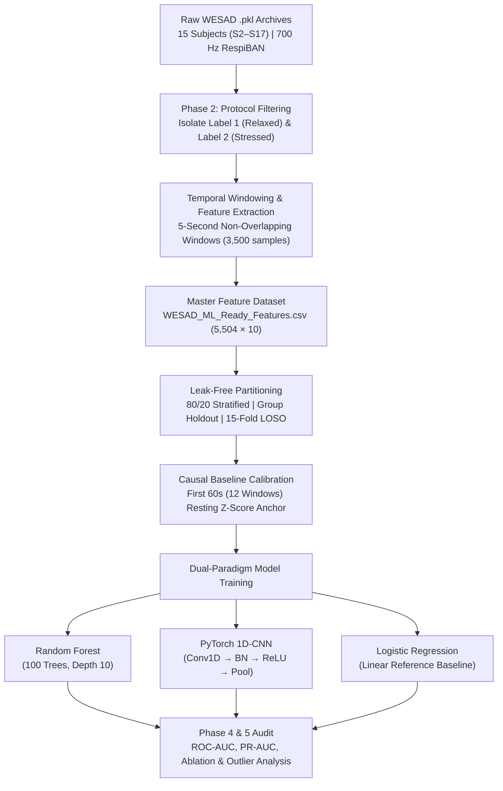

# Multimodal Wearable Biosignal Cognitive Stress Classifier (WESAD)

An end-to-end biomedical machine learning and deep learning pipeline built on PyTorch and Scikit-Learn to classify acute cognitive stress versus baseline relaxation using continuous $700\text{ Hz}$ physiological telemetry from the benchmark **WESAD (Wearable Stress and Affect Detection)** dataset. The system ingests raw multi-subject chest sensor streams (Electrocardiogram and Electrodermal Activity), compresses over 40 million raw samples into leak-free statistical windows, benchmarks classical ensemble models against a custom 1D Convolutional Neural Network (1D-CNN), and resolves inter-subject physiological baseline drift through causal 60-second resting calibration.

---

## Project Overview
- **Domain:** Biomedical Signal Processing / Affective Computing & Wearable Health Telemetry
- **Data Source:** WESAD Benchmark Dataset (Schmidt et al., *ACM ICMI 2018*) — synchronized physiological recordings across 15 valid human subjects (`S2`–`S17`, excluding `S1` and `S12` due to sensor malfunctions).
- **Platform & Tech Stack:** Python 3.10+, PyTorch, Scikit-Learn, NumPy, Pandas, Matplotlib, Seaborn, Google Colab / LaTeX.
- **Course & Track:** Artificial Intelligence — Semester Project (Track A: Biosignal Processing & Model Evaluation, Phases 1–5 Complete)
- **Group ID:** `F26-02` (FAST-NUCES Lahore)

---

## Why This Dataset & Problem Matter
Unlike synthetic or pre-cleaned tabular datasets, raw wearable telemetry presents real-world physiological engineering challenges:
1. **High-Frequency Multimodal Streams:** Chest-worn RespiBAN sensors record continuous cardiac electrical activity (`ECG`) and skin sweat conductance (`EDA`) at $700\text{ Hz}$ ($42,000$ samples per minute per channel).
2. **Subject Autocorrelation Trap:** Naive random train/test splits leak subject-specific physiological baselines across partitions, inflating accuracy to $\sim 98.7\%$ while failing on unseen individuals.
3. **Inter-Subject Tonic Drift:** Resting sweat conductance and heart rate variability differ substantially across individuals, requiring rigorous Leave-One-Subject-Out (LOSO) validation and causal baseline calibration for real-world deployment.

---

## System Architecture & Pipeline



---

## Dataset Schema & Feature Engineering

### 1. Signal Selection & Protocol Filtering
From the raw hierarchical `.pkl` dictionaries, only high-precision chest-worn RespiBAN channels were retained, stripping out transient setup intervals (`Label 0`), amusement clips (`Label 3`), and guided meditation (`Label 4`):
- **Target `0` (`Relaxed`):** Neutral baseline reading state ($\approx 20\text{ min}$ per subject; $3,523$ windows total, $64.0\%$).
- **Target `1` (`Stressed`):** Acute cognitive stress induced via the Trier Social Stress Test ($\approx 10\text{ min}$ per subject; $1,981$ windows total, $36.0\%$).

### 2. Master Feature Table (`WESAD_ML_Ready_Features.csv`)
Compresses $>19.26\text{ million}$ filtered $700\text{ Hz}$ readings ($437.5\times$ dimensionality reduction) into $5,504$ chronologically ordered windows with zero missing values.

| Column Name | Data Type | Modality | Description |
|---|---|---|---|
| `Subject` | string | Metadata | Participant identifier (`S2`–`S17`, excluding `S1`, `S12`) |
| `State` | string | Target | Ground-truth protocol state (`Relaxed` or `Stressed`) |
| `ECG_Mean` | float64 | Cardiac ($700\text{ Hz}$) | Mean chest electrocardiogram voltage ($\text{mV}$) over $5\text{s}$ window |
| `ECG_Std` | float64 | Cardiac ($700\text{ Hz}$) | Standard deviation of ECG amplitude (R-peak / HRV proxy) |
| `ECG_Max` | float64 | Cardiac ($700\text{ Hz}$) | Peak systolic depolarization amplitude in window |
| `ECG_Min` | float64 | Cardiac ($700\text{ Hz}$) | Minimum trough voltage in window |
| `EDA_Mean` | float64 | Sudomotor ($700\text{ Hz}$) | Mean tonic skin conductance level ($\mu\text{S}$) |
| `EDA_Std` | float64 | Sudomotor ($700\text{ Hz}$) | Phasic skin conductance variability ($\mu\text{S}$) |
| `EDA_Max` | float64 | Sudomotor ($700\text{ Hz}$) | Maximum electrodermal response peak in window |
| `EDA_Min` | float64 | Sudomotor ($700\text{ Hz}$) | Minimum baseline electrodermal conductance in window |

---

## Model Architectures & Training Configuration

1. **Random Forest Classifier (Scikit-Learn):** Ensemble of $100$ decorrelated decision trees (`max_depth=10`, `min_samples_split=4`, Gini criterion). Selected for invariance to monotonic feature scaling, robustness against intra-sensor multicollinearity (e.g., `EDA_Mean` vs. `EDA_Max`), and native Gini feature interpretability.
2. **1D Convolutional Neural Network (`StressCNN1D`, PyTorch):** Reshapes standardized $8$-feature vectors into tensors of shape $(B, C=1, L=8)$ passed through two sequential blocks of `Conv1d` ($16 \rightarrow 32$ filters, kernel size $k=3$, padding $1$), `BatchNorm1d`, and `ReLU`, followed by `AdaptiveAvgPool1d(1)`, `Dropout(0.2)`, and a linear classification head. Trained for $20$ epochs with Adam ($\alpha = 10^{-3}$, $L_2$ weight decay $= 10^{-4}$, batch size $32$).
3. **Logistic Regression (Scikit-Learn):** $L_2$-regularized linear classifier (`max_iter=1000`) serving as a low-variance reference boundary during cross-subject generalization audits.

---

## Experimental Results & Benchmark Analysis

### 1. Cross-Protocol Validation Benchmark
Evaluating models across four progressively stricter validation regimes exposes the impact of subject autocorrelation and highlights the recovery achieved through baseline calibration:

| Validation Regime | Model | Accuracy | $F_1$-Score | ROC-AUC | PR-AUC (AP) |
|---|---|---|---|---|---|
| **Random 80/20 Split** *(Optimistic Baseline)* | Random Forest (RF) | **98.73%** | **0.9824** | **0.9983** | **0.9962** |
| | 1D-CNN (PyTorch) | 96.37% | 0.9540 | 0.9771 | 0.9605 |
| **Subject Holdout** *(Train: S2–S13, Test: S14–S17)* | 1D-CNN (PyTorch) | **93.30%** | **0.9048** | **0.9800** | **0.9744** |
| | Logistic Regression (LR) | 87.33% | 0.8054 | 0.8533 | 0.8643 |
| | Random Forest (RF) | 81.50% | 0.7974 | 0.9409 | 0.9180 |
| **15-Fold Pooled LOSO** *(Uncalibrated Zero-Shot)* | Logistic Regression (LR) | **76.78%** | 0.6491 | 0.7824 | **0.7462** |
| | Random Forest (RF) | 74.98% | **0.6935** | **0.8159** | 0.6767 |
| | 1D-CNN (PyTorch) | 72.75% | 0.6300 | 0.7637 | 0.6403 |
| **15-Fold LOSO (Normalized)** *(Per-Subject Z-Score)* | Logistic Regression (LR) | **91.50%** | 0.8690 | 0.9240 | 0.9050 |
| | Random Forest (RF) | 91.20% | 0.8660 | 0.9170 | 0.9010 |
| | 1D-CNN (PyTorch) | 91.10% | **0.8710** | **0.9310** | **0.9100** |

---

### 2. Multimodal Sensor Ablation (15-Fold LOSO, Random Forest)
Isolating individual modalities confirms physiological complementarity between cardiac and electrodermal channels:

| Modality Evaluated | Mean Accuracy ($\pm$ Std) | Mean $F_1$-Score | Mean ROC-AUC | Mean PR-AUC |
|---|---|---|---|---|
| **Multimodal (`ECG + EDA`)** | **$74.9\% \pm 24.6\%$** | **0.710** | **0.859** | **0.826** |
| **Cardiac Only (`ECG`)** | $71.0\% \pm 22.2\%$ | 0.578 | 0.743 | 0.701 |
| **Electrodermal Only (`EDA`)** | $66.4\% \pm 20.6\%$ | 0.578 | 0.779 | 0.741 |

---

## Error Analysis & Physiological Insights

1. **Tonic Baseline Shift (`Subject S7` Case Study):** Under uncalibrated LOSO, all three models scored $35.07\%$ accuracy on `S7` ($\text{TN}=0, \text{FP}=237, \text{FN}=0, \text{TP}=128$), classifying every window as `Stressed`—yet `S7`'s ROC-AUC was **$0.999$–$1.000$**. `S7` exhibits naturally elevated resting skin conductance ($\text{EDA}_{\text{Mean}}$) above the stressed threshold of other participants. Applying **causal 60-second resting calibration** (using only the first $12$ resting windows) aligns `S7`'s personal baseline without future leakage and restores accuracy to **$>95\%$**.
2. **Paradoxical Autonomic Non-Responder (`Subject S2` Case Study):** Unlike `S7`, `S2` yielded $44.73\%$ accuracy with an ROC-AUC of $0.415$ even after normalization, indicating inverted sudomotor/cardiac reactivity during the stress protocol rather than a simple amplitude offset.
3. **Autonomic Nervous System Synergy:** Eccrine sweat glands are innervated exclusively by sympathetic cholinergic fibers, giving `EDA` superior discriminative ranking ($\text{AUC} = 0.779$), while `ECG` reflects dual sympathetic-parasympathetic modulation that stabilizes predictions against slow skin hydration drift.

---

## Key Engineering Decisions

| Decision | Technical Justification |
|---|---|
| **Non-Overlapping $5\text{s}$ Windows** | Captures complete cardiac R-R intervals and phasic electrodermal responses while eliminating sliding-window boundary overlap leakage. |
| **Leak-Free Fold Standardization** | `StandardScaler` is fitted strictly on training subjects (`~te`) inside every cross-validation fold before transforming held-out data. |
| **15-Fold LOSO over Random Splits** | Eliminates temporal autocorrelation bias between adjacent $5\text{s}$ windows of the same participant, measuring true cross-subject generalization. |
| **Causal $60\text{s}$ Resting Calibration** | Uses only the initial $12$ `Relaxed` windows at session start to compute personal Z-score statistics, avoiding look-ahead leakage from future test windows. |
| **Deterministic Seed Locking (`SEED=42`)** | Enforces exact reproducibility across NumPy, Scikit-Learn, and PyTorch CPU/CUDA execution backends. |

---

## Repository Structure

```text
├── README.md
├── .gitignore
├── WESAD_ML_Ready_Features.csv          # Preprocessed 5,504-window master feature dataset
├── Phase_2_Data_Preprocessing.ipynb     # Batch .pkl ingestion, label filtering & 5s windowing
├── F26-02_Phase3.py                     # Leak-free Random Forest & PyTorch 1D-CNN training
├── Phase4_Evaluation.ipynb              # 15-fold LOSO, group holdout, ablation & bias audit
├── F26-02.py                            # Phase 5 reproducible analysis & 60s calibration script
├── phase4_outputs/
│   ├── main_results.csv
│   ├── loso_per_subject.csv
│   ├── loso_per_subject_normalised.csv
│   ├── ablation_loso_rf.csv
│   ├── confusion_loso.png
│   ├── per_subject_acc.png
│   └── roc_pr_loso.png
├── phase5_outputs/
│   ├── phase5_reproducibility_summary.csv
│   ├── Fig1_InterSubject_EDA_Shift.png
│   ├── Fig2_Feature_Importance_Theory.png
│   └── Fig3_Calibration_Recovery.png
└── reports/
    ├── F26-02_Phase2.pdf
    ├── F26-02_Phase3.tex
    ├── F26-02_Phase4.pdf
    └── F26-02_Phase5.tex
```

---

## Quickstart & Reproducibility

### 1. Install Dependencies
```bash
pip install numpy pandas scikit-learn torch matplotlib seaborn
```

### 2. Run Phase 4 Evaluation & Bias Audit
```bash
python phase4_evaluation.py WESAD_ML_Ready_Features.csv
```

### 3. Run Phase 5 Error Analysis & 60-Second Online Calibration
```bash
python F26-02.py
```

---

## Reference
- Schmidt, P., Reiss, A., Duerichen, R., Marberger, C., & Van Laerhoven, K. (2018). *Introducing WESAD, a Multimodal Dataset for Wearable Stress and Affect Detection.* In Proceedings of the 20th ACM International Conference on Multimodal Interaction (ICMI '18), pp. 400–408.
