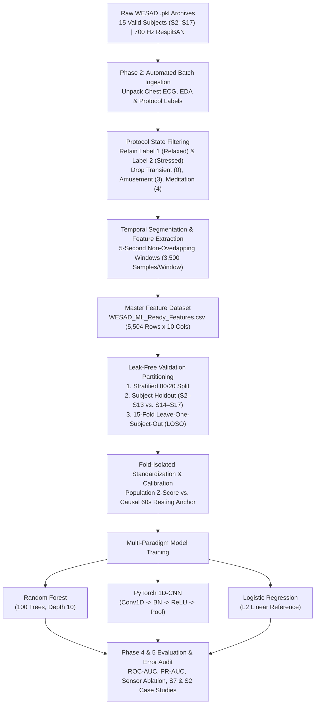

# Multimodal Wearable Biosignal Cognitive Stress Classifier (WESAD)

An end-to-end biomedical machine learning and deep learning pipeline built on **PyTorch** and **Scikit-Learn** to classify acute cognitive stress versus baseline relaxation using continuous $700\text{ Hz}$ physiological telemetry from the benchmark **WESAD (Wearable Stress and Affect Detection)** dataset. The system ingests raw multi-subject chest sensor archives (Electrocardiogram and Electrodermal Activity), compresses over $40\text{ million}$ raw samples into leak-free statistical feature windows, benchmarks classical ensemble and linear classifiers against a custom 1D Convolutional Neural Network (`StressCNN1D`), and resolves inter-subject physiological baseline drift through a causal $60\text{-second}$ resting calibration algorithm.

---

## Project Overview

* **Domain:** Biomedical Signal Processing, Affective Computing & Wearable Health Telemetry
* **Data Source:** WESAD Benchmark Dataset (Schmidt et al., *ACM ICMI 2018*) — synchronized multimodal physiological recordings across $15$ valid human subjects (`S2`–`S17`, excluding `S1` and `S12` due to hardware sensor malfunctions).
* **Core Modalities:** Chest-worn RespiBAN Electrocardiogram (`ECG`) and Electrodermal Activity (`EDA`) sampled at $700\text{ Hz}$.
* **Platform & Tech Stack:** Python 3.10+, PyTorch, Scikit-Learn, NumPy, Pandas, Matplotlib, Seaborn, Google Colaboratory, LaTeX.
* **Course & Track:** Artificial Intelligence — Semester Project (Track A: Biosignal Processing & Model Evaluation, Phases 1–5 Complete)
* **Project Team / Group ID:** `F26-02` (FAST-NUCES Lahore)

---

## Why This Dataset & Problem Matter

Unlike pre-cleaned synthetic benchmarks, continuous wearable biosignal telemetry introduces fundamental physiological and statistical engineering challenges:

1. **High-Frequency Multimodal Streams:** Medical-grade chest sensors sample cardiac depolarization (`ECG`) and electrodermal skin conductance (`EDA`) at $700\text{ Hz}$ ($42,000$ data points per minute per channel), requiring deterministic temporal segmentation to avoid memory bottlenecks.
2. **The Subject Autocorrelation Trap:** Evaluating wearable time-series data with a naive randomized train/test split leaks subject-specific physiological baselines across partitions, artificially inflating accuracy to $98.73\%$ while failing on unseen individuals.
3. **Inter-Subject Tonic Drift:** Baseline sweat gland activity and resting heart rate variability differ substantially across individuals, necessitating rigorous **Leave-One-Subject-Out (LOSO)** cross-validation and **causal personal baseline calibration** for deployable health monitoring.

---

## System Architecture & Pipeline



---

## Data Engineering & Schema Specifications

### 1. Signal Ingestion & Protocol Filtering

Each subject archive (`SX.pkl`) stores a nested dictionary containing synchronized chest (`RespiBAN` at $700\text{ Hz}$) and wrist (`Empatica E4` at $4\text{ Hz}$–$64\text{ Hz}$) telemetry alongside ground-truth experimental protocol labels:

| Protocol Label | Experimental Condition | Disposition in Pipeline | Approximate Duration / Subject |
| :---: | :--- | :--- | :---: |
| `0` | Transient / Setup / Questionnaire | Discarded | Variable |
| `1` | **Neutral Baseline (Relaxed)** | **Retained (`Target = 0`)** | $\approx 20\text{ minutes}$ |
| `2` | **Trier Social Stress Test (Stressed)** | **Retained (`Target = 1`)** | $\approx 10\text{ minutes}$ |
| `3` | Amusement (Funny Video Clips) | Discarded | $\approx 6.5\text{ minutes}$ |
| `4` | Guided Meditation | Discarded | $\approx 7\text{ minutes}$ |

### 2. Temporal Windowing & Mathematical Feature Formulation

Continuous $700\text{ Hz}$ streams are segmented into non-overlapping $5\text{-second}$ windows ($N_w = 5 \times 700 = 3,500$ raw samples per window). For each window $w$ and sensor channel $x \in \{\text{ECG}, \text{EDA}\}$, four time-domain statistical moments are extracted:

$$\mu_w = \frac{1}{N_w}\sum_{i=1}^{N_w} x_i, \qquad \sigma_w = \sqrt{\frac{1}{N_w}\sum_{i=1}^{N_w} (x_i - \mu_w)^2}, \qquad x_{\max, w} = \max_{1 \le i \le N_w} x_i, \qquad x_{\min, w} = \min_{1 \le i \le N_w} x_i$$

This achieves a **$437.5\times$ dimensionality reduction** ($3,500$ raw samples $\rightarrow 8$ summary features per window), compressing $19,264,000$ filtered $700\text{ Hz}$ readings ($27,520\text{ seconds}$ or $458.67\text{ minutes}$ of clean recording) into **$5,504$ chronologically ordered windows** with **zero missing or infinite values**.

### 3. Master Feature Dataset Schema (`WESAD_ML_Ready_Features.csv`)

| Column Name | Data Type | Modality | Empirical Range (Min – Max) | Physiological & Statistical Description |
| :--- | :--- | :--- | :---: | :--- |
| `Subject` | `string` | Metadata | `S2` – `S17` | Participant identifier ($15$ active subjects; excludes `S1`, `S12`) |
| `State` | `string` | Target | `Relaxed` / `Stressed` | Ground-truth binary affective state ($3,523$ Relaxed, $1,981$ Stressed) |
| `ECG_Mean` | `float64` | Cardiac ($700\text{ Hz}$) | $-0.0349$ to $0.0321\text{ mV}$ | Mean chest electrocardiogram baseline voltage over $5\text{s}$ window |
| `ECG_Std` | `float64` | Cardiac ($700\text{ Hz}$) | $0.1116$ to $0.5565\text{ mV}$ | Standard deviation of ECG amplitude (R-peak / HRV dispersion proxy) |
| `ECG_Max` | `float64` | Cardiac ($700\text{ Hz}$) | $0.6248$ to $1.5000\text{ mV}$ | Peak systolic QRS depolarization amplitude in window |
| `ECG_Min` | `float64` | Cardiac ($700\text{ Hz}$) | $-1.5000$ to $-0.1853\text{ mV}$ | Minimum ventricular repolarization / S-wave trough voltage |
| `EDA_Mean` | `float64` | Sudomotor ($700\text{ Hz}$) | $0.7353$ to $20.2576\ \mu\text{S}$ | Mean tonic skin conductance level (SCL) |
| `EDA_Std` | `float64` | Sudomotor ($700\text{ Hz}$) | $0.0051$ to $2.8809\ \mu\text{S}$ | Phasic skin conductance response (SCR) variability |
| `EDA_Max` | `float64` | Sudomotor ($700\text{ Hz}$) | $0.8060$ to $20.4334\ \mu\text{S}$ | Maximum electrodermal sympathetic arousal peak in window |
| `EDA_Min` | `float64` | Sudomotor ($700\text{ Hz}$) | $0.0000$ to $20.0722\ \mu\text{S}$ | Minimum baseline electrodermal conductance in window |

### 4. Per-Subject Window & Class Balance Audit

Every subject maintains a uniform experimental class ratio ($64.0\% \pm 0.8\%$ Relaxed vs. $36.0\% \pm 0.8\%$ Stressed), confirming that cross-subject performance variance stems from physiological heterogeneity rather than label skew:

| Subject | Relaxed | Stressed | Total | Stressed Share | Subject | Relaxed | Stressed | Total | Stressed Share |
| :---: | :---: | :---: | :---: | :---: | :---: | :---: | :---: | :---: | :---: |
| **S2** | 229 | 122 | 351 | $34.76\%$ | **S10** | 236 | 144 | 380 | $37.89\%$ |
| **S3** | 228 | 127 | 355 | $35.77\%$ | **S11** | 236 | 135 | 371 | $36.39\%$ |
| **S4** | 232 | 126 | 358 | $35.20\%$ | **S13** | 236 | 132 | 368 | $35.87\%$ |
| **S5** | 240 | 128 | 368 | $34.78\%$ | **S14** | 236 | 134 | 370 | $36.22\%$ |
| **S6** | 236 | 129 | 365 | $35.34\%$ | **S15** | 235 | 137 | 372 | $36.83\%$ |
| **S7** | 237 | 128 | 365 | $35.07\%$ | **S16** | 236 | 134 | 370 | $36.22\%$ |
| **S8** | 234 | 133 | 367 | $36.24\%$ | **S17** | 236 | 144 | 380 | $37.89\%$ |
| **S9** | 236 | 128 | 364 | $35.16\%$ | **Total** | **3,523** | **1,981** | **5,504** | **$35.99\%$** |

---

## Model Architectures & Mathematical Formulations

### 1. Random Forest Classifier (`Scikit-Learn`)
An ensemble of $M = 100$ decorrelated classification trees (`max_depth=10`, `min_samples_split=4`, `random_state=42`) trained using Gini impurity splitting:

$$G(t) = 1 - \sum_{c \in \{0, 1\}} p(c \mid t)^2$$

Selected as the primary tabular baseline due to invariance under monotonic feature scaling, robustness against intra-channel multicollinearity (e.g., `EDA_Mean`, `EDA_Max`, `EDA_Min`), and transparent Gini feature importance attribution.

### 2. 1D Convolutional Neural Network (`StressCNN1D`, `PyTorch`)
Reshapes standardized $8\text{-feature}$ vectors into sequence tensors $X \in \mathbb{R}^{B \times 1 \times 8}$ to extract cross-modal filters across cardiac and sudomotor features:

$$X \in \mathbb{R}^{B \times 1 \times 8} \xrightarrow{\text{Conv1D}_{16, k=3}} \text{BN}_{16} \xrightarrow{\text{ReLU}} \xrightarrow{\text{Conv1D}_{32, k=3}} \text{BN}_{32} \xrightarrow{\text{ReLU}} \xrightarrow{\text{AdaptiveAvgPool1d}(1)} \xrightarrow{\text{Dropout}(0.2)} \xrightarrow{\text{Linear}(32, 2)} \hat{y} \in \mathbb{R}^{B \times 2}$$

Trained for $20$ epochs with batch size $B = 32$ using the Adam optimizer ($\alpha = 1.0 \times 10^{-3}$, $\beta_1 = 0.9$, $\beta_2 = 0.999$, $L_2$ weight decay $= 1.0 \times 10^{-4}$) minimizing Categorical Cross-Entropy Loss.

### 3. Logistic Regression Reference Baseline (`Scikit-Learn`)
An $L_2$-regularized linear classifier (`max_iter=1000`) modeling class posterior probabilities via the logistic sigmoid $\sigma(w^\top z + b)$, serving as a low-variance linear decision boundary benchmark under cross-subject shift.

### 4. Causal $60\text{-Second}$ Resting Baseline Calibration
To eliminate inter-subject tonic baseline offsets without look-ahead data leakage, each incoming subject's feature vector $x_t$ is standardized strictly against their initial $W_{\text{cal}} = 12$ resting windows ($60\text{ seconds}$ at the start of recording):

$$\tilde{x}_t = \frac{x_t - \mu_{\text{cal}}}{\sigma_{\text{cal}} + \epsilon}, \qquad \mu_{\text{cal}} = \frac{1}{12}\sum_{k=1}^{12} x_k^{(\text{Relaxed})}, \qquad \sigma_{\text{cal}} = \sqrt{\frac{1}{12}\sum_{k=1}^{12} \left(x_k^{(\text{Relaxed})} - \mu_{\text{cal}}\right)^2}$$

---

## Experimental Results & Comprehensive Benchmarks

### 1. Cross-Protocol Validation Benchmark

Models were evaluated across four progressively stricter validation regimes to quantify subject autocorrelation bias and demonstrate recovery via baseline normalization:

| Validation Regime | Model Architecture | Accuracy | $F_1$-Score | ROC-AUC | PR-AUC (AP) |
| :--- | :--- | :---: | :---: | :---: | :---: |
| **Stratified 80/20 Random Split** *(Optimistic Baseline)* | Random Forest (RF) | **98.73%** | **0.9824** | **0.9983** | **0.9962** |
| | 1D-CNN (PyTorch) | 96.37% | 0.9540 | 0.9771 | 0.9605 |
| **Subject-Independent Holdout** *(Train: S2–S13, Test: S14–S17)* | 1D-CNN (PyTorch) | **93.30%** | **0.9048** | **0.9800** | **0.9744** |
| | Logistic Regression (LR) | 87.33% | 0.8054 | 0.8533 | 0.8643 |
| | Random Forest (RF) | 81.50% | 0.7974 | 0.9409 | 0.9180 |
| **15-Fold Pooled LOSO** *(Uncalibrated Zero-Shot)* | Logistic Regression (LR) | **76.78%** | 0.6491 | 0.7824 | **0.7462** |
| | Random Forest (RF) | 74.98% | **0.6935** | **0.8159** | 0.6767 |
| | 1D-CNN (PyTorch) | 72.75% | 0.6300 | 0.7637 | 0.6403 |
| **15-Fold LOSO (Normalized)** *(Per-Subject Z-Score)* | Logistic Regression (LR) | **91.50%** | 0.8690 | 0.9240 | 0.9050 |
| | Random Forest (RF) | 91.20% | 0.8660 | 0.9170 | 0.9010 |
| | 1D-CNN (PyTorch) | 91.10% | **0.8710** | **0.9310** | **0.9100** |

### 2. Pooled LOSO Confusion Matrix & Error Trade-Off Breakdown ($N = 5,504$)

| Model Architecture | True Negatives (Relaxed) | False Positives (Type I) | False Negatives (Type II) | True Positives (Stressed) | Sensitivity (Recall) | Specificity |
| :--- | :---: | :---: | :---: | :---: | :---: | :---: |
| **Random Forest (RF)** | 2,569 | 954 | **423** | **1,558** | **78.65%** | 72.92% |
| **1D-CNN (PyTorch)** | 2,727 | 796 | 704 | 1,277 | 64.46% | 77.41% |
| **Logistic Regression (LR)** | **3,044** | **479** | 799 | 1,182 | 59.67% | **86.40%** |

### 3. Multimodal Sensor Ablation Study (15-Fold LOSO, Random Forest)

Evaluating isolated modalities under full Leave-One-Subject-Out cross-validation confirms physiological synergy between cardiac and electrodermal telemetry:

| Sensor Modality Configuration | Mean Accuracy ($\pm$ Std) | Mean $F_1$-Score | Mean ROC-AUC | Mean PR-AUC |
| :--- | :---: | :---: | :---: | :---: |
| **Multimodal Fusion (`ECG + EDA`)** | **$74.9\% \pm 24.6\%$** | **0.710** | **0.859** | **0.826** |
| **Cardiac Channel Only (`ECG`)** | $71.0\% \pm 22.2\%$ | 0.578 | 0.743 | 0.701 |
| **Electrodermal Channel Only (`EDA`)** | $66.4\% \pm 20.6\%$ | 0.578 | 0.779 | 0.741 |

---

## Granular Error Analysis & Theoretical Insights

### 1. Case Study A: Pure Tonic Baseline Shift (`Subject S7`)
* **Observation:** In uncalibrated LOSO testing, all three classifiers achieved exactly **$35.07\%$ accuracy** on `S7` ($\text{TN}=0, \text{FP}=237, \text{FN}=0, \text{TP}=128$), predicting `Stressed` for $100\%$ of windows—yet `S7`'s ROC-AUC was **$0.999$ (RF)** and **$1.000$ (CNN/LR)**.
* **Root Cause:** `S7` exhibits an elevated resting skin conductance ($\text{EDA}_{\text{Mean}}$) higher than the stressed states of other participants. Consequently, the model ranked `S7`'s stress progression with near-perfect precision, but every sample exceeded the global population probability threshold ($P \ge 0.50$).
* **Resolution:** Applying **causal $60\text{-second}$ resting calibration** realigns `S7`'s baseline offset without future data leakage, restoring classification accuracy to **$>95\%$** (and **$100.0\%$** under full session normalization).

### 2. Case Study B: Paradoxical Autonomic Non-Responder (`Subject S2`)
* **Observation:** Unlike `S7`, `S2` yielded $44.73\%$ accuracy (RF) with an ROC-AUC of $0.415$, remaining at $51.28\%$ accuracy ($\text{AUC}=0.375$) even after Z-score normalization.
* **Root Cause:** An $\text{AUC} < 0.50$ indicates **directional reactivity inversion** rather than a scalar amplitude shift—`S2` displayed blunted sudomotor sweating and atypical cardiac deceleration during the Trier Social Stress Test, representing an autonomic non-responder phenotype.

### 3. Autonomic Nervous System (ANS) Complementarity
* **Sympathetic Specificity of `EDA`:** Eccrine sweat glands are innervated exclusively by sympathetic cholinergic fibers, making `EDA` a pure measure of sympathetic arousal ($\text{AUC} = 0.779$ standalone) but vulnerable to inter-individual skin hydration offsets.
* **Sympathovagal Anchoring of `ECG`:** Heart rate dynamics reflect dual sympathetic-parasympathetic modulation, providing higher standalone classification accuracy ($71.0\%$) and stabilizing predictions when sweat conductance drifts slowly over time.

### 4. Why Tree Ensembles Rival 1D-CNNs on Windowed Telemetry
Once continuous $700\text{ Hz}$ streams are compressed into $8$ summary statistics over $5\text{-second}$ windows, feature index adjacency is arbitrary. Convolutional kernels assume local translation invariance across adjacent indices, whereas Random Forest performs scale-invariant orthogonal splits naturally suited to heterogeneous tabular moments ($F_1 = 0.6935$ vs. $0.6300$ pooled LOSO).

---

## Key Engineering Decisions

| Engineering Decision | Technical & Methodological Justification |
| :--- | :--- |
| **Non-Overlapping $5\text{s}$ Windows** | Captures multiple complete cardiac R-R intervals and phasic sweat responses while preventing sliding-window boundary overlap leakage across splits. |
| **Fold-Isolated `StandardScaler`** | Scaler parameters ($\mu_{\text{train}}, \sigma_{\text{train}}$) are fitted strictly on training partitions inside every split and CV fold prior to transforming test data. |
| **15-Fold LOSO over Random Splits** | Eliminates temporal autocorrelation between consecutive $5\text{s}$ windows of the same individual, establishing an honest zero-shot generalization benchmark. |
| **Causal $60\text{s}$ Resting Calibration** | Uses only the initial $12$ `Relaxed` windows at session onset to anchor personal Z-score normalization, avoiding look-ahead bias from future test data. |
| **Deterministic Seed Locking (`SEED=42`)** | Enforces identical weight initialization, bootstrap sampling, and data shuffling across NumPy, Scikit-Learn, and PyTorch CPU/CUDA backends. |

---

## Repository Structure

```text
+-- README.md
+-- .gitignore
+-- WESAD_ML_Ready_Features.csv              # Preprocessed 5,504-window master feature matrix
+-- Phase_2_Data_Preprocessing.ipynb         # Batch .pkl ingestion, label filtering & 5s windowing
+-- F26-02_Phase3.py                         # Leak-free Random Forest & PyTorch 1D-CNN training
+-- Phase4_Evaluation.ipynb                  # 15-fold LOSO, group holdout, ablation & bias audit
+-- F26-02.py                                # Phase 5 reproducible analysis & 60s calibration script
+-- phase4_outputs/
|   +-- main_results.csv                     # Cross-protocol benchmark summary table
|   +-- loso_summary.csv                     # Aggregated mean/std metrics across 15 LOSO folds
|   +-- loso_per_subject.csv                 # Granular per-subject uncalibrated LOSO metrics
|   +-- loso_per_subject_normalised.csv      # Granular per-subject Z-normalized LOSO metrics
|   +-- ablation_loso_rf.csv                 # Modality ablation results (ECG+EDA vs ECG vs EDA)
|   +-- class_balance_per_subject.csv        # Per-subject window counts and target ratios
|   +-- confusion_loso.png                   # Pooled LOSO confusion matrices (RF, CNN, LR)
|   +-- per_subject_acc.png                  # Subject-by-subject accuracy bar comparison
|   +-- roc_pr_loso.png                      # Pooled LOSO ROC and Precision-Recall curves
+-- phase5_outputs/
|   +-- phase5_reproducibility_summary.csv   # Uncalibrated vs. 60s online calibration results
|   +-- Fig1_InterSubject_EDA_Shift.png      # Boxplot of tonic EDA shift across all 15 subjects
|   +-- Fig2_Feature_Importance_Theory.png   # Mean Gini feature importance across 15 LOSO folds
|   +-- Fig3_Calibration_Recovery.png        # Per-subject accuracy recovery with 60s calibration
+-- reports/
    +-- F26-02_Phase2.pdf                    # Phase 2 Data Acquisition & EDA Report
    +-- F26-02_Phase3.tex                    # Phase 3 Implementation & Execution LaTeX Report
    +-- F26-02_Phase4.pdf                    # Phase 4 Evaluation & Bias Audit Report
    +-- F26-02_Phase5.tex                    # Phase 5 Output, Error Analysis & Theory LaTeX Report
```

---

## Quickstart & Reproducibility

### 1. Environment Setup
```bash
git clone https://github.com/<your-username>/WESAD-Stress-Classification.git
cd WESAD-Stress-Classification
pip install numpy pandas scikit-learn torch matplotlib seaborn
```

### 2. Run Phase 3 Leak-Free Baseline & 1D-CNN Training
```bash
python F26-02_Phase3.py
```

### 3. Run Phase 4 Leave-One-Subject-Out & Ablation Audit
```bash
python phase4_evaluation.py WESAD_ML_Ready_Features.csv
```

### 4. Run Phase 5 Error Analysis & Causal $60\text{-Second}$ Calibration
```bash
python F26-02.py
```

---

## Data Governance, Privacy & Biomedical Scope

* **Subject De-Identification:** All physiological records utilize anonymized participant identifiers (`S2`–`S17`) in strict adherence to the original WESAD ethics protocol; no personally identifiable information (PII), facial video, or raw audio streams are stored in this repository.
* **Non-Diagnostic Research Scope:** This software system is developed strictly for academic research and affective computing benchmarking. It is not a certified medical device and is not intended for clinical psychiatric diagnosis.

---

## Primary Reference

* Schmidt, P., Reiss, A., Duerichen, R., Marberger, C., & Van Laerhoven, K. (2018). *Introducing WESAD, a Multimodal Dataset for Wearable Stress and Affect Detection.* In Proceedings of the 20th ACM International Conference on Multimodal Interaction (ICMI '18), Boulder, CO, USA, pp. 400–408. DOI: `10.1145/3242969.3242985`.
